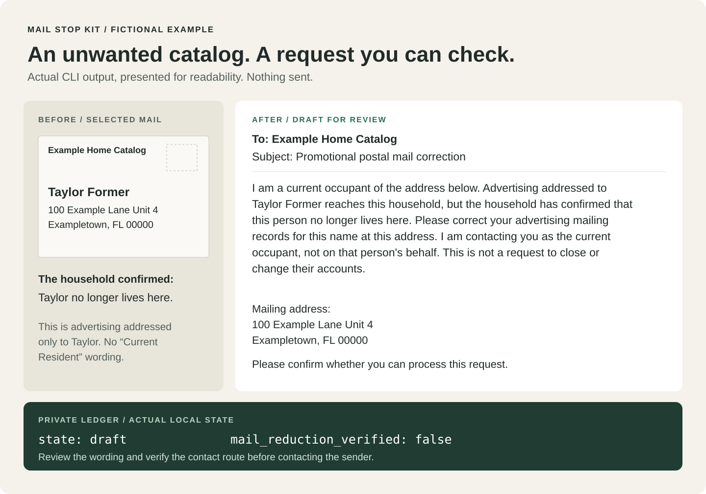

# Mail Stop Kit

[](https://github.com/maam00/mail-stop-kit/actions/workflows/tests.yml)
[](LICENSE)

Turn a few unwanted envelopes into the right drafts and a record of what happened.

For people using a local agent to clean up physical mail: separate your advertising, a former resident's mail, and mail addressed to **Current Resident**. Prepare sender-specific requests, write a local-postmaster letter when appropriate, and track responses without treating “request received” as “mail stopped.”

Python 3.11+. The review core has no runtime dependencies, account, mailbox connection or model API. Optional Lob letters use your own key and account; you pay Lob directly. **Public alpha: `0.1.0rc3`.** Procedures apply to US mail. All examples are fictional.

[](docs/before-after.md)

[Read the exact draft and reproduce it](docs/before-after.md). When a physical letter is the right route, the [optional Lob adapter](docs/mailing.md) lets you review the PDF and cost, approve it, and submit through **your own Lob account**. No separate Mail Stop account or subscription.

## Try it in two minutes

Download the [source](https://github.com/maam00/mail-stop-kit/archive/refs/heads/main.zip), or clone it:

```sh
git clone https://github.com/maam00/mail-stop-kit.git
cd mail-stop-kit
```

From the repository folder:

```sh
python3 -m mail_stop plan --household examples/household.json --mail examples/mail.json
```

The six examples produce these decisions, with explanations:

| Envelope | Result |
|---|---|
| Alex's catalog | Draft an advertising-only request |
| Confirmed former resident's catalog | Draft a correction as the current occupant |
| “Taylor Former or Current Resident” | Draft an address-based advertising request |
| Unfamiliar name | Ask the household; don't invent former residency |
| “Explanation of Benefits” labeled as an ad | Protect for review |
| Sealed letter for a confirmed former resident | Return unopened; don't act on their accounts |

That command writes nothing and contacts nobody. To install the command:

```sh
python3 -m venv .venv
.venv/bin/python -m pip install .
.venv/bin/mail-stop --help
```

The source command works without installation. `pip` may download its build tools; review and drafting work offline. Only the explicit Lob send/reconcile commands contact Lob. On Windows, the virtual environment executables are in `.venv\Scripts`.

## Use it with your agent

Point your existing agent at [SKILL.md](SKILL.md), then give it a small selection of envelope images or text you chose:

> Read SKILL.md. Alex and Sam live here; Taylor is a confirmed former resident. Review these selected envelopes, prepare the right requests, and show me the drafts. Ask about unfamiliar names. Don't contact anyone yet.

The agent or person transcribes selected evidence into the [input format](docs/input.md). This kit does not perform OCR, read a mailbox, or decide that an extraction was checked by a person. `reviewed_fields` must reflect actual review. Keep real input files outside this checkout.

## Keep drafts and follow-up in one place

Use a dedicated private folder. This example records **synthetic** drafts:

```sh
python3 -m mail_stop prepare --household examples/household.json --mail examples/mail.json --data "$HOME/.local/share/mail-stop-demo"
python3 -m mail_stop list --data "$HOME/.local/share/mail-stop-demo"
```

`prepare` returns draft IDs. Substitute one for `DRAFT_ID`:

```sh
python3 -m mail_stop export DRAFT_ID --data "$HOME/.local/share/mail-stop-demo"
python3 -m mail_stop show DRAFT_ID --data "$HOME/.local/share/mail-stop-demo"
```

`export` prints the plain-text draft. Review the intended recipient, current official contact route and wording before using your email, browser or printer. Sending through Lob or an agent’s other tools needs approval for the specific external action.

After you actually submit a request elsewhere, record what you know:

```sh
python3 -m mail_stop record DRAFT_ID --data "$HOME/.local/share/mail-stop-demo" --event submitted --source user_report --evidence "I submitted the reviewed request through the sender's official form."
python3 -m mail_stop record DRAFT_ID --data "$HOME/.local/share/mail-stop-demo" --event acknowledged --source provider_message --evidence "The sender's message acknowledges receipt, not completion." --reference "case-example-123"
```

These commands record evidence; they do not perform or independently verify the actions. For test receipts, uncertain results, subsequent envelopes and closing a case, see [outcomes](docs/outcomes.md).

## A letter to the local delivery office

Select reviewed pieces addressed only to confirmed former residents. Verify the **local delivery office's** address yourself. This fictional example prepares a draft:

```sh
python3 -m mail_stop office-draft --household examples/household.json --mail examples/mail.json --piece-id former-letter --office-address "99 Example Postal Way, Exampletown FL 00000" --data "$HOME/.local/share/mail-stop-demo"
```

Export the returned draft ID to review or print it. Current Resident and unfamiliar-name examples cannot enter this letter. It does not request a change of address for another person, prescribe an internal USPS form, or promise a deadline.

USPS accepts local complaints by phone, email, letter or in person; certified mail is not required by that guidance. [USPS DMM 608 §6.1](https://pe.usps.com/text/dmm300/608.htm) The optional [Lob mailing guide](docs/mailing.md) includes exact content PDF preview, address/service review, account-specific price consent, one-attempt submission and receipt reconciliation.

## Optional letters through your Lob account

Install PDF support, then use the ID returned by the fictional `office-draft` above as `OFFICE_DRAFT_ID` to prepare a **local test-mode preview**. Nothing is submitted by these commands:

```sh
.venv/bin/python -m pip install ".[lob]"
.venv/bin/mail-stop lob-prepare OFFICE_DRAFT_ID --addresses examples/lob-addresses.json --data "$HOME/.local/share/mail-stop-demo"
```

Open the returned PDF and review the address/service manifest. The PDF is the exact content uploaded; Lob adds an address page and any service barcode material. A real send requires an explicit key file and approval for the returned digest. Live mode additionally requires a fresh account-specific estimate, acceptance that actual charges may differ, and `--allow-live`. No enforced price cap is claimed.

A timeout or interrupted process locks the attempt; reconcile it rather than sending again. Lob's duplicate protection expires after 24 hours, while this kit preserves its local send lock. See [the complete sequence and recovery rules](docs/mailing.md).

**Validation:** PDF and submission logic are covered by offline tests with fake transports. This release candidate has not been exercised against Lob's authenticated test or live API. No live printing or delivery has been verified for this kit.

## Two paper notes mailed to your household

`household-kit` reuses the existing mailbox-kit idea: one current-recipient name note stays by the mailbox, and a separate carrier copy identifies confirmed former recipients. Both are cutouts on one ordinary letter sheet. They are not cardstock, an official USPS form or a change-of-address request. Correctly addressed Current Resident/Occupant mail remains valid.

```sh
mail-stop household-kit --household examples/household.json --recipient "Alex Example" --data "$HOME/.local/share/mail-stop-demo"
```

Use the returned kit ID with `lob-prepare`, supplying a private addresses file whose **to and from are the confirmed current household**, with the selected current resident as recipient. It uses the same PDF approval, price consent and one-attempt safeguards. It cannot be redirected to a former recipient or the postmaster, and does not offer certified service. You can print the local PDF yourself instead. See [household kit](docs/household-kit.md).

## What needs an email, form or letter next?

```sh
mail-stop routes
mail-stop routes --id valpak
mail-stop attach-route DRAFT_ID --route PRIVATE_ROUTE.json --data PRIVATE_FOLDER
mail-stop next --data PRIVATE_FOLDER
```

The directory contains researched suggestions for Valpak, Save and separate L.L.Bean business/consumer routes. You explicitly match and verify a route for the case; similar names never get matched automatically. Attach the exact channel/destination, official source, checked date, eligibility and required steps. A researched route is not yet verified for your household.

`next`/`agenda` shows route verification, prerequisites, review, confirmation, waiting or a chosen review date. It does not run background jobs or contact anyone. Advertising letters through Lob require a current verified **postal** route; an email/form route is not permission for a paid letter fallback. [Route input and follow-up](docs/routes.md).

## What the kit knows

Run `python3 -m mail_stop playbooks` for six source-linked procedures checked October 19, 2026: former residents, Current Resident mail, local delivery complaints, catalogs, DMAchoice and OptOutPrescreen. They guide review rather than automate forms. Recheck provider details before acting; prices and service participation change.

The useful distinction is supported by USPS: occupant/exceptional-address mail is delivered as addressed, while genuinely misdirected named-recipient mail has a different handling procedure. [USPS addressing rules](https://pe.usps.com/text/dmm300/602.htm), [misdelivered-mail guidance](https://faq.usps.com/articles/Knowledge/How-is-Undeliverable-and-Misdelivered-Mail-Handled).

## Privacy and limits

The ledger contains names, addresses, drafts and supplied evidence. On POSIX systems its folder is mode `0700` and database `0600`; it is **not encrypted**. Export/show/JSON output can contain that private information. Your agent may send selected inputs to its own model provider under its settings; offline kit code does not make a cloud agent local. Keep household inputs and exports out of Git, shared logs and screenshots. See [SECURITY.md](SECURITY.md).

An envelope does not reveal all its contents. An Informed Delivery image does not prove physical delivery. A receipt does not establish suppression. Unknown mail and potentially important notices stay outside advertising removals. This kit cannot stop every mailing or change another person's accounts.

## Develop and contribute

```sh
.venv/bin/python -m unittest discover -s tests -v
```

Install `.[lob]` to run PDF/adapter tests; those tests are explicitly skipped without the optional extra.

Tests use temporary stores and synthetic inputs, with no credentials or provider calls. Useful contributions are corrected official-source procedures and realistic synthetic regression cases. See [CONTRIBUTING.md](CONTRIBUTING.md). The routing and request-history ideas were extracted from the private Mailroom project; its hosted service and household archive are not included. MIT licensed.
